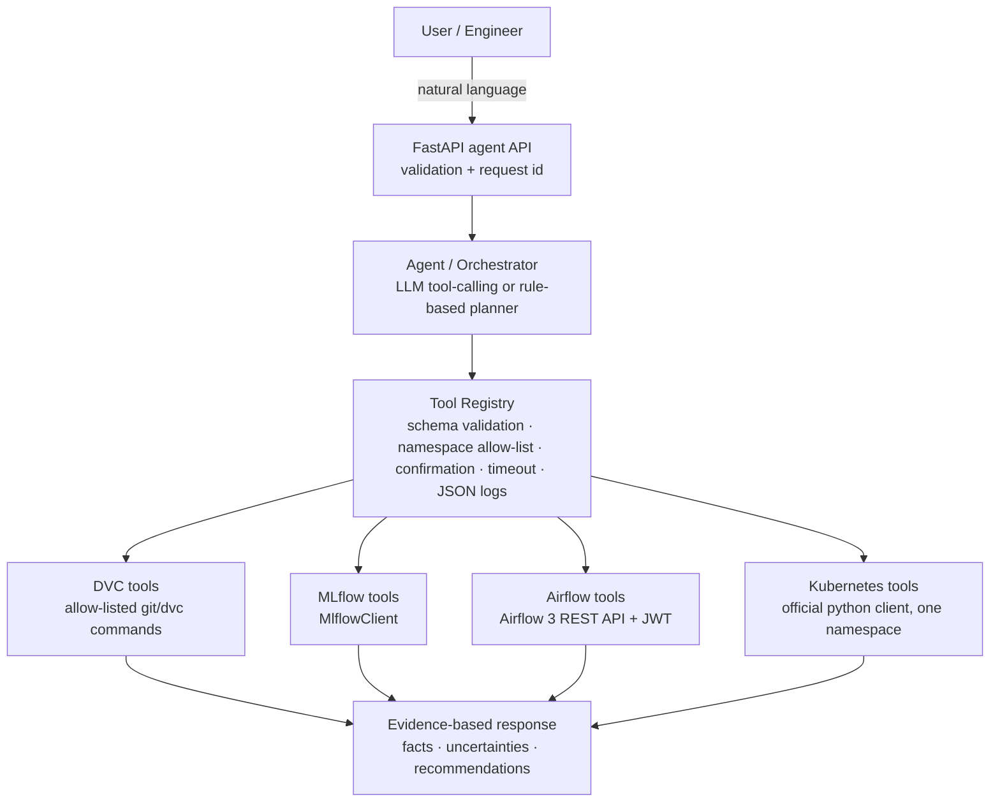

# Architecture

## Components

## Data / provenance flow
`dvc add` → `data/dataset.csv.dvc` (md5) committed to Git → the training run (CLI or Airflow) records `dataset.version`, `dvc.md5`,
`dvc.path`, `git.commit` as **MLflow tags** → `dvc_experiment_dataset` reads those tags and *verifies* them against Git
(`git show <commit>:data/dataset.csv.dvc`) → `dvc_explain_reproduce` prints the exact checkout commands.

## Training DAG (Airflow 3)
`validate_dataset → preprocess → train_model → evaluate_and_log → quality_gate → register_model`
* `retries=2`, `retry_delay=20s` for transient errors. Data validation and quality-gate failures raise `AirflowFailException` (no retry).
* A failed gate stops the DAG: `register_model` (promotion, copies the model used by the Docker image) never runs.
* The gate also tags the MLflow run `quality_gate=passed|failed`, which the agent reads.

## Kubernetes application
Deployment (2 replicas, rolling update) · ClusterIP Service · readiness `/ready` (model loaded) and liveness `/health` · requests/limits ·
ConfigMap (non-sensitive: version, model path, model run id, dataset version) · RBAC Role limited to the namespace.

## Tool catalogue and permissions
| Module | Tool | Permission |
|---|---|---|
| DVC | `dvc_list_tracked_datasets`, `dvc_get_dataset_version`, `dvc_status`, `dvc_compare_versions`, `dvc_experiment_dataset`, `dvc_explain_reproduce` | read |
| MLflow | `mlflow_list_experiments`, `mlflow_list_runs`, `mlflow_get_run`, `mlflow_best_run`, `mlflow_compare_runs`, `mlflow_registry_info` | read |
| Airflow | `airflow_list_dags`, `airflow_dag_runs`, `airflow_task_instances`, `airflow_failed_tasks`, `airflow_task_logs` | read |
| Airflow | `airflow_trigger_dag` (approved DAGs only) | **write – needs confirmation** |
| Kubernetes | `k8s_list_workloads`, `k8s_pod_logs`, `k8s_list_services`, `k8s_diagnose`, `k8s_app_version` | read |
| Kubernetes | `k8s_restart_deployment`, `k8s_scale_deployment` (1–5) | **write – needs confirmation, approved namespace** |

(`GET /tools` returns this catalogue live.)

## Why these choices
* **Tool registry as a single choke point** – safety does not depend on the LLM behaving; the LLM cannot set the confirmation flag.
* **Two planners, one safety layer** – LLM mode for flexible language; deterministic rule mode for offline demos, tests, and as an LLM-outage fallback.
* **Provenance in MLflow tags + verification in Git** – the answer to "which dataset version?" comes from *recorded* evidence, not memory.
* **Lazy imports** of MLflow / Kubernetes / Anthropic – CI stays light and all external calls are mockable.

## Known limitations
* Rule-based planner is keyword-driven (limited phrasing); LLM mode is more flexible.
* Tool timeouts stop waiting but cannot kill the underlying thread.
* Airflow runs in standalone dev mode with a dev password; use a real auth manager in production.
* The model is baked into the Docker image (simple, reproducible); a production system would pull from the MLflow registry/artifact store.
* Readiness verdicts are heuristic (policy threshold, gate tag, provenance, margin); no drift or latency monitoring.
